<!-- Profile art is reproducible from the scripts/ directory. -->

<h3><code>alexsandrrh@github:~$ whoami</code></h3>

<strong>Senior Frontend Developer | React &amp; TypeScript | Node.js &amp; NestJS | AI Agents</strong>

<table>
<tr>
<td valign="top"></td>
<td valign="top"></td>
</tr>
</table>

[Русская версия](./README.ru.md) · [LinkedIn](https://www.linkedin.com/in/alexsandrrh/) · [Telegram](https://t.me/alexsandrrh) · [Email](mailto:sascha.sadov@yandex.ru)

I'm a frontend developer working professionally since 2018, mainly with React and TypeScript. In smaller teams, I also build backend services, integrations, bots, and AI agents.

I like working on products from the start: shaping the first release, choosing a manageable scope, and building on it in stages. I also work on existing applications, improving their architecture, development tooling, and reusable UI.

### Selected projects

- **[bouncing-dvd-animation](https://github.com/Alexsandrrh/bouncing-dvd-animation)** — a React and TypeScript animation component. Frame updates run through `requestAnimationFrame`; movement logic is separate from React and covered by unit tests. Includes an example app and usage documentation.
- **[form-ui](https://github.com/Alexsandrrh/form-ui)** — TypeScript contracts and Zod schemas for form field configurations. Includes validation rules, tests, and examples. This is the schema layer; it does not include a form renderer.

### Stack

- **Frontend:** React, TypeScript, Vite, TanStack Query, Tailwind CSS, MobX.
- **Backend:** Node.js, Bun, NestJS, Prisma ORM, REST APIs, webhooks.
- **AI and messaging:** LangChain, LangGraph, Telegram Mini Apps, Telegram and MAX bots.

Contribution calendar

<!-- Refreshed daily by .github/workflows/update-profile-art.yml. -->

